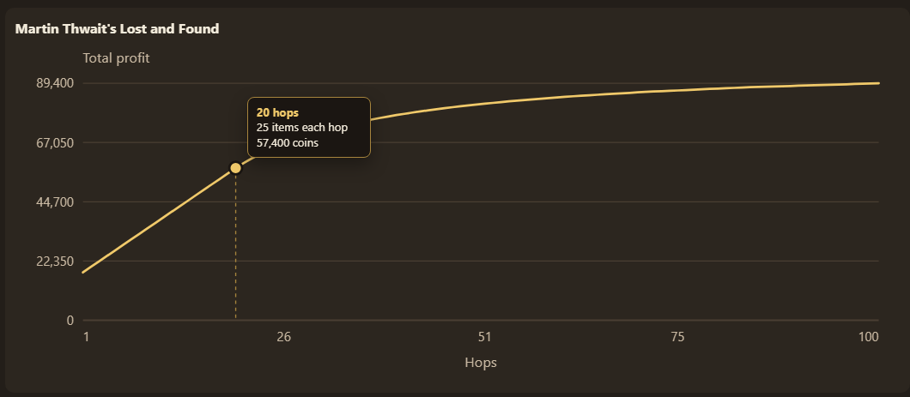

# OSRS Shop Hop Sell Calculator

OSRSSHSC helps maximize your profit from selling items in Old School RuneScape shops.

Go to: https://f0nkey.github.io/osrs-sell-sim/

## Synopsis

Stores in Old School RuneScape pay less for each additional copy of an item you sell them.
The price drops by a fixed percentage of the item’s base value with each sale (typically 3% for standard stores).

If you sell 3 magic logs, without hopping worlds, the buy price will drop by 3% for each additional log sold.
- 1st sale: 128 gp
- 2nd sale: 118 gp
- 3rd sale: 108 gp

Total Profit: 354

But if you hop to a new world, the price resets to the base value the shop buys it for.
- 1st sale: 128
- 2nd sale: 128
- 3rd sale: 128

Total Profit: 384

Hopping to a new world with fresh stock resets the price. 

This calculator estimates profit based on the number of hops.

It also scans shop data from the wiki's [storeline bucket](https://oldschool.runescape.wiki/w/Bucket:Storeline), to detect special pricing from specialty shops.